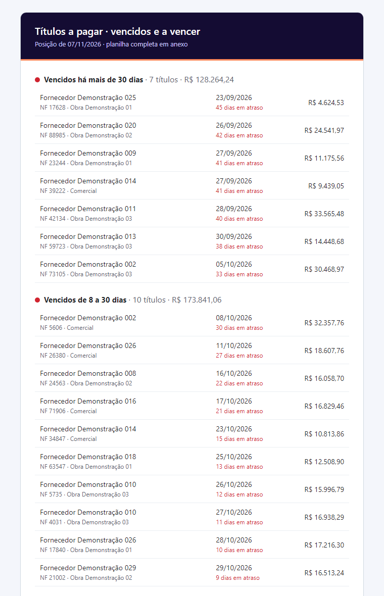

<h1 align="center">Relatórios automáticos</h1>

<p align="center">
  <b>Relatório diário que sai do banco, vira um e-mail bonito (inclusive no Outlook) com a planilha completa em anexo e
  roda sozinho no Agendador de Tarefas do Windows, sem janela na tela.</b>
</p>

<p align="center">
  
  
  
  
</p>

---

## O problema

Toda manhã alguém abria o sistema, filtrava os títulos vencidos, copiava para o Excel e mandava por e-mail. Quando essa
pessoa faltava, ninguém recebia, e o fornecedor ligava cobrando.

## A solução

Um robô que roda às 7h, consulta o banco, separa os títulos por urgência e entrega a lista **pronta para agir**: o que
está mais atrasado primeiro, com dias em atraso e centro de custo, e a planilha completa em anexo para quem quiser filtrar.

<p align="center"></p>

## Rodando

```bash
git clone https://github.com/EdyVerder/relatorios-automaticos.git
cd relatorios-automaticos
python -m pip install -r requirements.txt
python -m relatorio --simular        # gera saida/relatorio.eml (abre no Outlook) e saida/previa.html
python -m pytest -q                  # 6 testes, nenhum envia e-mail
```

Para enviar de verdade, tire o `--simular` e defina `SMTP_HOST`, `SMTP_PORTA`, `SMTP_USUARIO` e `SMTP_SENHA` no
ambiente. Destinatários e cópia ficam em [`config.json`](config.json).

Para agendar (Windows, PowerShell como administrador):

```powershell
.\agendador\instalar_tarefa.ps1 -Hora 07:00
```

A tarefa chama [`executar_oculto.vbs`](agendador/executar_oculto.vbs), que roda o Python **sem abrir console** na
tela de quem estiver usando o servidor.

## Detalhes que fazem diferença

- **HTML de e-mail de verdade**: tabelas e estilo em linha, porque o Outlook ignora CSS moderno.
- **Texto puro alternativo**: quem lê sem HTML não recebe uma tela em branco.
- **Planilha pronta para uso**: cabeçalho fixo, filtro, data e moeda formatadas.
- **Credenciais fora do código**: só variáveis de ambiente; nada de senha em log.
- **Modo simulação**: dá para conferir o e-mail exato antes de ligar o envio.

A mesma base serve para qualquer relatório diário: muda a consulta e o agrupamento; o resto é igual.

---

<p align="center"><sub>Feito por <a href="https://github.com/EdyVerder">Rocha</a> · fornecedores e valores fictícios · licença MIT</sub></p>
